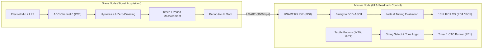

# Digital Audio Tuner (Dual-Node ATmega328P)

[](https://www.microchip.com/)
[](https://www.microchip.com/en-us/product/ATmega328P)
[](https://gcc.gnu.org/wiki/avr-gcc)
[](https://www.labcenter.com/)

A high-precision chromatic guitar tuner built from scratch in pure **AVR Assembly** targeting two interconnected **ATmega328P** microcontrollers. The architecture isolates real-time analog signal acquisition from user interface rendering, eliminating latency-induced data loss and jitter.

---

## 1. System Architecture

Real-time audio pitch detection requires high-frequency sampling and cycle-accurate period calculation. In contrast, driving a 16x2 character LCD over an I2C (PCF8574) expander introduces significant blocking delays (hundreds of microseconds per transmission). 

To solve this concurrency bottleneck, the system utilizes a **Dual-Node Master-Slave topology** communicating via USART (9600 baud, 8-N-1):



### Node Responsibilities

1. **Slave Node (Signal Acquisition & Processing):**
   - Continuously samples the analog audio signal via ADC Channel 0 (`PC0`).
   - Implements digital hysteresis with dual thresholds to reject noise and spurious oscillations.
   - Measures fundamental signal wave periods using 16-bit **Timer 1** at clock-cycle resolution.
   - Converts cycle counts to frequency ($f = \frac{f_{clk}}{N}$) and transmits 16-bit binary data over USART TX (`PD1`).

2. **Master Node (User Interface & Feedback Control):**
   - Receives real-time frequency data via non-blocking USART RX Interrupt (`PD0`).
   - Converts binary frequency values into decimal BCD-ASCII digits.
   - Compares measured frequencies against a flash-stored **Chromatic Lookup Table** ($E_2$ to $E_4$, 25 chromatic notes) with proportional $\pm 5\text{ cent}$ tolerance windows.
   - Updates tuning status (`TOO LOOSE`, `NICE`, `TOO TIGHT`) on an I2C 16x2 LCD.
   - Supports string target switching (`INT0`) and reference pitch generation (`INT1`) using Timer 1 in CTC mode driving a passive buzzer (`PB1`).

---

## 2. Hardware Design & Pinout

### Key Components

| Component | Specification | Quantity | Role |
| :--- | :--- | :---: | :--- |
| **Microcontroller** | ATmega328P (or Arduino Uno) | 2 | Master & Slave processing units |
| **Microphone Module** | GY-MAX4466 Electret Mic with Preamp | 1 | Acoustic guitar sound capture |
| **Display** | 16x2 Character LCD with PCF8574 I2C Backpack | 1 | Real-time frequency and tuning UI |
| **Audio Output** | Passive Buzzer (5V) | 1 | Reference pitch generator (Timer 1 CTC) |
| **Inputs** | Tactile Push Buttons (Pull-Up) | 2 | Target string toggle (`INT0`) & Tone toggle (`INT1`) |
| **Low-Pass Filter** | Resistor $4.7\text{ k}\Omega$ + Capacitor $100\text{ nF}$ | 1 | Hardware antialiasing / high-frequency cutoff ($\approx 338\text{ Hz}$) |
| **Debounce Circuit** | Resistor $10\text{ k}\Omega$ + Capacitor $100\text{ nF}$ | 2 | Hardware debouncing per button |

### Pin Allocation

#### Slave Node
| Pin | Function | Description |
| :--- | :--- | :--- |
| `PC0` (ADC0) | Analog Input | Filtered microphone signal |
| `PD1` (TXD) | Digital Output | USART Transmit to Master `PD0` |
| `GND` | Power | Common ground with Master node |

#### Master Node
| Pin | Function | Description |
| :--- | :--- | :--- |
| `PD0` (RXD) | Digital Input | USART Receive from Slave `PD1` |
| `PC4` (SDA) | I2C Data | PCF8574 LCD I2C Serial Data |
| `PC5` (SCL) | I2C Clock | PCF8574 LCD I2C Serial Clock |
| `PD2` (INT0) | External Interrupt 0 | Target string selection button |
| `PD3` (INT1) | External Interrupt 1 | Reference pitch buzzer toggle button |
| `PB1` (OC1A) | Output Compare 1A | Timer 1 square wave driving the passive buzzer |

---

## 3. Signal Conditioning & Detection Algorithm

### Analog Low-Pass Filter
Guitar strings in standard tuning span from $E_2$ ($82.41\text{ Hz}$) to $E_4$ ($329.63\text{ Hz}$). A passive RC low-pass filter is placed between the microphone output and the ADC:

$$f_c = \frac{1}{2 \pi R C} = \frac{1}{2 \pi \cdot 4700 \cdot 100 \times 10^{-9}} \approx 338.6\text{ Hz}$$

This effectively suppresses unwanted higher-order harmonics, pick clatter, and ambient high-frequency noise.

### Digital Hysteresis & Zero-Crossing
To prevent false triggers around the virtual ground / bias voltage ($V_{cc}/2 \approx 512$ at 10-bit ADC resolution), the detection algorithm enforces two hysteresis thresholds:

1. **Phase 1 (Falling Edge):** Waits until the ADC reading drops below **511** (`0x01FF`).
2. **Phase 2 (Rising Edge - Trigger):** Starts Timer 1 when the signal crosses above **513** (`0x0201`).
3. **Phase 3 & 4 (Complete Cycle):** Waits for the next cycle's falling and rising edges to capture the exact elapsed timer counts.
4. **Timeout Watchdog:** If no crossing occurs within a preset timeout, the node forces a transmission of $0\text{ Hz}$ to clear the display.

---

## 4. Musical Note Mapping & Tuning Reference

The Master node features a 25-note chromatic lookup table spanning 2 full octaves ($E_2$ to $E_4$). The standard 6-string guitar configuration maps to:

| String | Note | Target Frequency ($f_0$) | Tolerance Window ($\pm 5\text{ Cents}$) |
| :---: | :---: | :---: | :---: |
| 6 | **E2** | $82.41\text{ Hz}$ | $82.17\text{ Hz} - 82.64\text{ Hz}$ |
| 5 | **A2** | $110.00\text{ Hz}$ | $109.68\text{ Hz} - 110.32\text{ Hz}$ |
| 4 | **D3** | $146.83\text{ Hz}$ | $146.41\text{ Hz} - 147.25\text{ Hz}$ |
| 3 | **G3** | $196.00\text{ Hz}$ | $195.43\text{ Hz} - 196.57\text{ Hz}$ |
| 2 | **B3** | $246.94\text{ Hz}$ | $246.23\text{ Hz} - 247.66\text{ Hz}$ |
| 1 | **E4** | $329.63\text{ Hz}$ | $328.68\text{ Hz} - 330.58\text{ Hz}$ |

> [!NOTE]
> Tolerances are calculated proportionally in musical cents ($1\text{ cent} = 2^{1/1200}$ ratio), ensuring narrower tolerance for low-frequency bass strings and broader absolute frequency bands for treble strings.

---

## 5. Repository Structure

```
Chromatic-Guitar-Tuner/
├── .gitignore               # Ignored build artifacts and Proteus temporary files
├── README.md                # Project documentation
├── sim.pdsprj               # Proteus Design Suite schematic & simulation project
├── master/                  # Master Node Source Files (UI, LCD, Audio)
│   ├── main.S               # Main entry point, interrupt setup, state loop
│   ├── lcd_i2c.S            # TWI/I2C low-level bit/byte transfer primitives
│   ├── lcd_driver.S         # HD44780 / PCF8574 LCD initialization & commands
│   ├── lookup_table.S       # Chromatic note frequencies & string indices in Flash
│   ├── bcd_ascii.S          # 16-bit binary to BCD decimal ASCII string converter
│   ├── mapping.S            # Frequency comparator and tuning evaluation logic
│   ├── display.S            # LCD rendering routines and string formatters
│   ├── buzzer_core.S        # Timer 1 CTC reference pitch generator driver
│   ├── usart_rx.S           # Asynchronous interrupt-driven USART receiver
│   └── master.hex           # Compiled Intel HEX binary for Master MCU
└── slave/                   # Slave Node Source Files (Signal Acquisition)
    ├── slave.S              # ADC sampling, hysteresis zero-crossing, period math
    └── slave.hex            # Compiled Intel HEX binary for Slave MCU
```

---

## 6. Building & Simulation

### Compiling from Source

Using the `avr-gcc` toolchain:

```bash
# 1. Compile Slave Firmware
avr-gcc -mmcu=atmega328p -nostartfiles -O2 -o slave/slave.elf slave/slave.S
avr-objcopy -O ihex slave/slave.elf slave/slave.hex

# 2. Compile Master Firmware
avr-gcc -mmcu=atmega328p -nostartfiles -O2 -o master/master.elf master/main.S
avr-objcopy -O ihex master/master.elf master/master.hex
```

### Running in Proteus

1. Open `sim.pdsprj` in **Proteus 8 Professional** (v8.9 or later recommended).
2. Right-click the **Master ATmega328P** $\rightarrow$ *Edit Properties* $\rightarrow$ Set *Program File* to `master/master.hex` and Clock Frequency to `16MHz`.
3. Right-click the **Slave ATmega328P** $\rightarrow$ *Edit Properties* $\rightarrow$ Set *Program File* to `slave/slave.hex` and Clock Frequency to `16MHz`.
4. Press **Run the simulation** (`F12`). Adjust the audio signal generator / potentiometer input to observe real-time pitch detection on the LCD.
